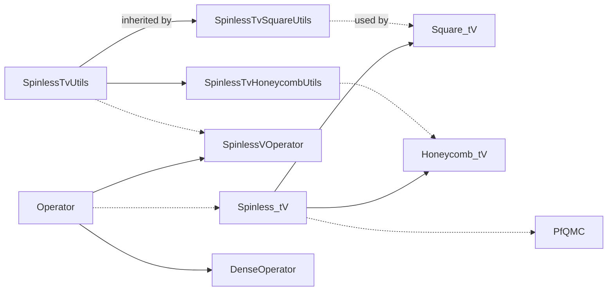

# Pfaffian Quantum Monte Carlo (PfQMC)

A prototype implementation of the Pfaffian Quantum Monte Carlo (PfQMC) algorithm for simulating fermionic quantum many-body systems. This repository implements the spinless t-V model with possible p+ip pairing term, and the interacting Kitaev chain.

Check on our paper [arXiv:2408.10311](https://arxiv.org/abs/2408.10311) for a complete description of the algorithm and related derivations.

## Usage


The repo relies on the [PFAPACK](https://arxiv.org/abs/1102.3440) for Pfaffian-related calculations, included in `inc/pfapack`. [Eigen](https://eigen.tuxfamily.org/) library, along with the Intel® oneAPI Math Kernel Library ([oneMKL](https://www.intel.com/content/www/us/en/developer/tools/oneapi/onemkl.html)) is used for matrix operations.

For the verified local WSL2/oneAPI environment, exact dependency paths, build
commands, and runtime examples, read [CONTEXT.md](CONTEXT.md).

To build with CMake, run the following from the repository root in Bash. Set
`EIGEN3_INCLUDE_DIR` to the directory containing `Eigen/`; add
`-DCMAKE_PREFIX_PATH=/path/to/prefix` if GoogleTest is installed outside the
system paths.

```bash
source /opt/intel/oneapi/setvars.sh
make -C inc/pfapack/fortran mFC=ifx
make -C inc/pfapack/c_interface
cmake -S . -B build -DCMAKE_CXX_COMPILER=mpiicpx \
  -DEIGEN3_INCLUDE_DIR=/path/to/eigen3
cmake --build build -j 2
ctest --test-dir build --output-on-failure
```

See `.github/workflows/main.yml` for a complete build and test workflow.

## Four-mode sign-free validation

The [four-mode validation](<sign_free_verify/README.md>) implements a Hermitian
pairing model and Gaussian auxiliary fields, cross-checking exact Fock traces,
an auxiliary representation formula, and the existing signed Pfaffian routines.
Build target `sign_free_check`; its small regression is included in CTest.
See the [validation report](<sign_free_verify/REPORT.md>) for recorded random samples
and the original program's build and runtime results.

## Additional sign-free Hamiltonians

The [sign-free Hamiltonian catalog](sign_free_catalog/README.md) implements the
remaining examples audited from the local sign-free notes: 27 Gaussian-HS
presets integrated with `PfQMC`, static sectors, and separately identified
worldline/non-Hermitian extensions. See the [physics formulas](sign_free_catalog/MODELS.md)
and [signed numerical checks](sign_free_catalog/RESULTS.md). Build target:
`sign_free_models`; the original program and four-mode validator remain available.

## Program Design




## Performance benchmarks

See [the reproducible performance workflow](bench/README.md) and
[measured large-lattice results](bench/RESULTS.md) for the interaction-block
optimization, regression checks, and baseline comparisons.


The catalog records **21 distinct Hamiltonian constructions** after merging parameter variants.
Only **6** have confirmed ordinary Gaussian-HS auxiliary-field PfQMC positivity; **15 remain
unconfirmed in that representation**. The other positive weights use the explicitly labeled
sector, CT, worldline, or SSE representations. See the [model index and per-family proofs](sign_free_catalog/MODELS.md#最终索引与统一计数),
[signed numerical evidence](sign_free_catalog/SEARCH_RESULTS.md#最终汇总), and
[Hamiltonian/configuration APIs](sign_free_catalog/README.md). The final suite passes 84 tests.
